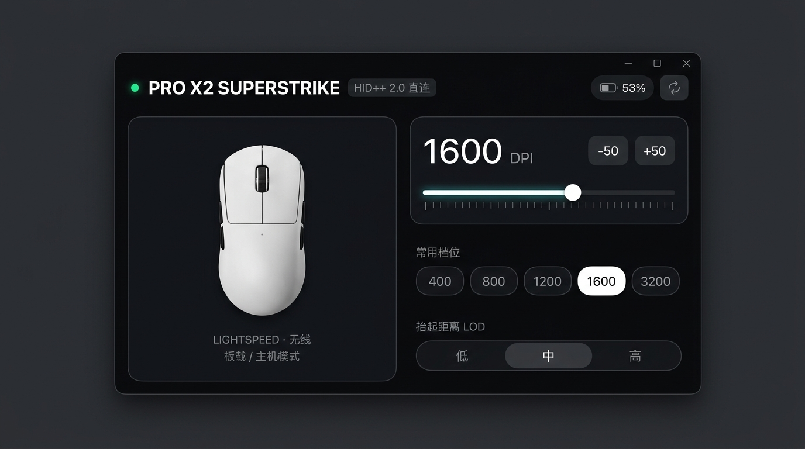

# logi-dpi

A tiny, instant-launch native Windows DPI controller for modern Logitech LIGHTSPEED gaming mice (**PRO X2 SUPERSTRIKE**, **PRO X Superlight 2**, etc.) built with **MoonBit + [mbui](https://github.com/AFK-surf/monoid)** and direct **Win32 USB HID++ 2.0** (`0x2202` Extended Adjustable DPI).

No Logitech G HUB. No "Loading resources…" infinite spinner. No background services. No Electron.

## Features

- **Direct USB HID++ 2.0 (`0x2202`)**: Reads and writes hardware DPI directly over the LIGHTSPEED receiver (`VID_046D&PID_C54D` / `C547` / `C539`) with zero G HUB dependency.
- **Auto Host-Mode Handshake (`0x8100`)**: Automatically switches onboard-locked mice to host mode before writing live DPI so firmware accepts changes immediately.
- **Interactive Ticked Slider & Presets**: Smoothly drag or click along the 200–4000 DPI scale (50 DPI steps), fine-tune with `-50 / +50`, or jump to `400 / 800 / 1200 / 1600 / 3200`.
- **Lift-Off Distance (LOD)**: Switch between Low (`1`), Medium (`2`), and High (`3`) LOD directly on the sensor.
- **Live Battery (`0x1004`)**: Reads Unified Battery percentage directly from the mouse.
- **Auto-Save & Sleep/Wake Guard**: Saves your DPI & LOD to `config.ini`, minimizes to the Windows system tray on close, automatically restores your DPI if the mouse wakes from sleep or reconnects, and includes a one-click Windows autostart (`--tray`) toggle.
- **Native GPU-Rendered UI**: Built with MoonBit `mbui` (Direct3D / Direct2D / DirectWrite) — ~4.3 MB single binary, instant cold start, native Windows 11 dark title bar.

## Quick Start (Windows x64)

1. Download `MouseDPI-win-x64.zip` from [Releases](https://github.com/zzj3720/logi-dpi/releases).
2. Extract `MouseDPI.exe` and `mouse.png` to the same folder.
3. Run `MouseDPI.exe` (close G HUB if it is holding the HID++ interface).

## Protocol Notes (HID++ 2.0)

| Feature ID | Name | Usage |
|---|---|---|
| `0x0000` | `IRoot` | Resolve feature indices dynamically |
| `0x1004` | `UNIFIED_BATTERY` | Read live battery percentage (`fn=1`) |
| `0x2202` | `EXTENDED_ADJUSTABLE_DPI` | Read (`fn=5`) & write (`fn=6`) X/Y DPI and LOD |
| `0x8100` | `ONBOARD_PROFILES` | Read mode (`fn=2`) & set host mode (`fn=1`, `0x02`) |

## Building from Source

Requires [MoonBit](https://www.moonbitlang.com/), Visual Studio 2022 Build Tools (`x64`), and the `mbui` framework (`libs/mbui`):

1. Copy `src/mousedpi/` into `libs/mbui/src/mousedpi/`.
2. Initialize VS 2022 x64 environment (`vcvars64.bat`) with `CL=/utf-8 /EHsc`.
3. Build with `moon build --release --target native src/mousedpi` in the staged Windows module (`out/win/mod`).

## License

MIT © 2026 zzj3720
